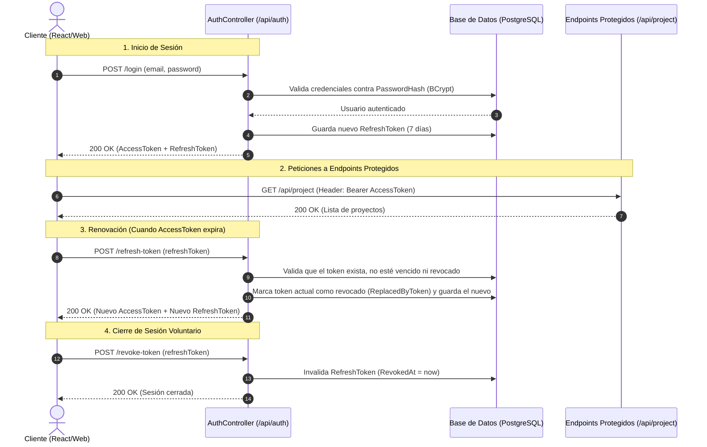

# 📘 Documentación Técnica Completa de la API — Project Proposals Backend

Documento maestro de referencia para el backend **Project Proposals**, desarrollado en **.NET 8** bajo los principios de **Clean Architecture**, **CQRS con MediatR** y **Seguridad JWT con Refresh Tokens tradicionales**.

---

## 1. Información General y Pipeline de Seguridad

### 1.1. Servidores y Swagger UI
* **Ambiente de Desarrollo Local**: `https://localhost:7084` / `http://localhost:5242`
* **Swagger UI Interactivo**: `https://localhost:7084/swagger`
  > En Swagger UI puedes utilizar el botón **Authorize** ingresando:  
  > `Bearer <tu_access_token>`  
  > para probar interactivamente todos los endpoints protegidos.

### 1.2. Esquema de Autenticación
* **Header HTTP Estándar**:
  ```http
  Authorization: Bearer <accessToken>
  ```
* **Access Token (JWT)**:
  * Vigencia: `15 minutos`.
  * Algoritmo: `HMAC-SHA256`.
  * Claims incluidas: `sub` / `NameIdentifier` (ID de usuario), `email`, `name`, `role` (nombre del rol), `roleId` (ID numérico del rol), `jti` (identificador único del token).
* **Refresh Token (Tradicional)**:
  * Vigencia: `7 días`.
  * Formato: Token criptográfico aleatorio seguro de 64 bytes base64url.
  * Transmisión: **Método tradicional vía JSON payload** (en cuerpo de petición y respuesta, sin cookies).
  * Persistencia: Almacenado en tabla `RefreshToken` de PostgreSQL.

### 1.3. Ciclo de Vida y Seguridad de Tokens (Diagrama de Secuencia)



### 1.4. Medidas de Seguridad Clave
1. **Rotación de Tokens (Token Rotation)**: Cada vez que se utiliza un refresh token para renovar sesión, dicho token es invalidado de inmediato y se entrega un nuevo refresh token junto con el nuevo access token.
2. **Detección de Reúso (Token Reuse Detection)**: Si un atacante intercepta un refresh token y la víctima o el atacante lo utiliza, el segundo intento detectará que el token ya estaba revocado. Ante este evento, el backend revoca **todas las sesiones activas** del usuario preventivamente.
3. **Prevención de Suplantación de Identidad**: En `POST /api/project` y `PATCH /api/project/{id}/decision`, la identidad del solicitante o decisor se extrae directamente de las claims del token autenticado (`ICurrentUserService`), impidiendo que un usuario se haga pasar por otro.
4. **Formato Uniforme de Respuestas de Error**: Todos los errores (400, 401, 403, 404, 409, 500) devuelven el esquema JSON estándar:
   ```json
   {
     "message": "Descripción clara del error ocurrido."
   }
   ```

---

## 2. Usuarios de Prueba y Credenciales

Todos los usuarios iniciales del sistema tienen configurada la siguiente contraseña:
> **Contraseña**: `Password123!`

| ID | Nombre | Correo Electrónico | Rol Aprobador | ID de Rol |
| :---: | :--- | :--- | :--- | :---: |
| **1** | José Ferreyra | `jferreyra@unaj.com` | Gerente | 2 |
| **2** | Ana Lucero | `alucero@unaj.com` | Líder de Área | 1 |
| **3** | Gonzalo Molinas | `gmolinas@unaj.com` | Gerente | 2 |
| **4** | Lucas Olivera | `lolivera@unaj.com` | Director | 3 |
| **5** | Danilo Fagundez | `dfagundez@unaj.com` | Comité Técnico | 4 |
| **6** | Gabriel Galli | `ggalli@unaj.com` | Comité Técnico | 4 |
| **7** | Mariana Torres | `mtorres@unaj.com` | Líder de Área | 1 |
| **8** | Carlos Mendoza | `cmendoza@unaj.com` | Director | 3 |

---

## 3. Índice Resumido de Endpoints

| Módulo | Método | Ruta | Acceso | Descripción |
| :--- | :---: | :--- | :---: | :--- |
| **Auth** | `POST` | `/api/auth/login` | Público | Autenticación con email y contraseña. Retorna JWT y Refresh Token. |
| **Auth** | `POST` | `/api/auth/refresh-token` | Público | Renueva el Access Token y rota el Refresh Token. |
| **Auth** | `POST` | `/api/auth/revoke-token` | `[Authorize]` | Cierra la sesión activa revocando el Refresh Token. |
| **Auth** | `GET` | `/api/auth/me` | `[Authorize]` | Devuelve el perfil del usuario autenticado actual. |
| **Proyectos** | `POST` | `/api/project` | `[Authorize]` | Crea una propuesta y calcula sus pasos de aprobación. |
| **Proyectos** | `GET` | `/api/project/{id}` | `[Authorize]` | Detalle completo de una propuesta y sus pasos por ID. |
| **Proyectos** | `GET` | `/api/project` | `[Authorize]` | Listado con filtros (`title`, `status`, `applicant`, `approvalUser`). |
| **Proyectos** | `PATCH` | `/api/project/{id}` | `[Authorize]` | Modifica información general de la propuesta. |
| **Proyectos** | `PATCH` | `/api/project/{id}/decision` | `[Authorize]` | Registra decisión (Aprobar/Rechazar/Observar) sobre un paso. |
| **Proyectos** | `GET` | `/api/project/rolepending/{role}` | `[Authorize]` | Proyectos pendientes esperando decisión de un rol específico. |
| **Catálogos** | `GET` | `/api/Area` | `[Authorize]` | Catálogo de áreas organizacionales. |
| **Catálogos** | `GET` | `/api/ProjectType` | `[Authorize]` | Catálogo de tipos de proyecto. |
| **Catálogos** | `GET` | `/api/Role` | `[Authorize]` | Catálogo de roles de aprobación. |
| **Catálogos** | `GET` | `/api/ApprovalStatus` | `[Authorize]` | Catálogo de estados de aprobación. |
| **Catálogos** | `GET` | `/api/User` | `[Authorize]` | Catálogo de usuarios registrados con sus roles. |

*(Nota: Los endpoints de Auth también admiten las rutas sin prefijo `/api`: `/auth/login`, `/auth/refresh-token`, `/auth/revoke-token`, `/auth/me`).*

---

## 4. Módulo de Autenticación (`/api/auth`)

### 4.1. Iniciar Sesión (`Login`)
* **Ruta**: `POST /api/auth/login` (o `/auth/login`)
* **Acceso**: Público (`[AllowAnonymous]`)
* **Request Body** (`LoginRequest`):
  ```json
  {
    "email": "jferreyra@unaj.com",
    "password": "Password123!"
  }
  ```
* **Respuestas**:
  * **200 OK** (`AuthResponse`):
    ```json
    {
      "accessToken": "eyJhbGciOiJIUzI1NiIsInR5cCI6IkpXVCJ9...",
      "refreshToken": "xH4n9L2qW-7mP1kR8vT0yA...",
      "tokenType": "Bearer",
      "expiresIn": 900,
      "user": {
        "id": 1,
        "name": "José Ferreyra",
        "email": "jferreyra@unaj.com",
        "role": {
          "id": 2,
          "name": "Gerente"
        }
      }
    }
    ```
  * **400 Bad Request**: Campos obligatorios faltantes o email inválido.
  * **401 Unauthorized**: Credenciales incorrectas o usuario inexistente.

---

### 4.2. Renovar Token (`RefreshToken`)
* **Ruta**: `POST /api/auth/refresh-token` (o `/auth/refresh-token`)
* **Acceso**: Público (`[AllowAnonymous]`)
* **Request Body** (`RefreshTokenRequest`):
  ```json
  {
    "refreshToken": "xH4n9L2qW-7mP1kR8vT0yA..."
  }
  ```
* **Respuestas**:
  * **200 OK**: Retorna un nuevo Access Token y un nuevo Refresh Token (el anterior queda revocado inmediatamente).
  * **400 Bad Request**: Token no suministrado.
  * **401 Unauthorized**: Token inválido, expirado o intento de reúso de token revocado.

---

### 4.3. Revocar Token / Cerrar Sesión (`RevokeToken`)
* **Ruta**: `POST /api/auth/revoke-token` (o `/auth/revoke-token`)
* **Acceso**: Requiere autenticación (`[Authorize]`)
* **Headers**: `Authorization: Bearer <accessToken>`
* **Request Body** (`RevokeTokenRequest`):
  ```json
  {
    "refreshToken": "xH4n9L2qW-7mP1kR8vT0yA..."
  }
  ```
* **Respuestas**:
  * **200 OK**:
    ```json
    {
      "message": "Sesión cerrada y token revocado exitosamente."
    }
    ```
  * **401 Unauthorized**: No autenticado o token JWT inválido.
  * **404 Not Found**: El refresh token indicado no existe.

---

### 4.4. Perfil del Usuario Actual (`GetCurrentUser`)
* **Ruta**: `GET /api/auth/me` (o `/auth/me`)
* **Acceso**: Requiere autenticación (`[Authorize]`)
* **Headers**: `Authorization: Bearer <accessToken>`
* **Respuestas**:
  * **200 OK** (`UserResponse`):
    ```json
    {
      "id": 1,
      "name": "José Ferreyra",
      "email": "jferreyra@unaj.com",
      "role": {
        "id": 2,
        "name": "Gerente"
      }
    }
    ```
  * **401 Unauthorized**: Token JWT ausente o inválido.

---

## 5. Módulo de Propuestas de Proyectos (`/api/project`)

### 5.1. Crear Propuesta de Proyecto
Evalúa las reglas de negocio en `IApprovalStepEngine`, aplicando deduplicación estricta de roles y ordenamiento jerárquico organizacional (`HierarchyLevel`) para generar una secuencia continua de pasos sin duplicados ni huecos.
* **Ruta**: `POST /api/project`
* **Acceso**: Requiere autenticación (`[Authorize]`).
* **Request Body** (`ProjectProposalCreateRequest`):
  ```json
  {
    "title": "Migración a Infraestructura Cloud 2026",
    "description": "Migración de los servidores locales a arquitectura en la nube.",
    "amount": 25000,
    "duration": 6,
    "area": 2,
    "type": 3
  }
  ```
* **Respuestas**:
  * **201 Created** (`ProjectResponse`):
    ```json
    {
      "id": "e7c2a58b-90f6-4d03-bf6a-493cf3745281",
      "title": "Migración a Infraestructura Cloud 2026",
      "description": "Migración de los servidores locales a arquitectura en la nube.",
      "amount": 25000,
      "duration": 6,
      "createAt": "2026-10-08T21:40:00Z",
      "status": {
        "id": 1,
        "name": "Pending"
      },
      "area": {
        "id": 2,
        "name": "Tecnología"
      },
      "type": {
        "id": 3,
        "name": "Infraestructura"
      },
      "user": {
        "id": 1,
        "name": "José Ferreyra"
      },
      "steps": [
        {
          "id": 101,
          "stepOrder": 1,
          "approverRole": {
            "id": 2,
            "name": "Gerente"
          },
          "status": {
            "id": 1,
            "name": "Pending"
          },
          "decisionDate": null,
          "observations": null,
          "approverUser": null
        },
        {
          "id": 102,
          "stepOrder": 2,
          "approverRole": {
            "id": 3,
            "name": "Director"
          },
          "status": {
            "id": 1,
            "name": "Pending"
          },
          "decisionDate": null,
          "observations": null,
          "approverUser": null
        }
      ]
    }
    ```
  * **400 Bad Request**: Campos requeridos incompletos, área o tipo inexistente, o título duplicado.
  * **401 Unauthorized**: No autenticado.

---

### 5.2. Obtener Propuesta por ID
* **Ruta**: `GET /api/project/{id:guid}`
* **Acceso**: Requiere autenticación (`[Authorize]`)
* **Respuestas**:
  * **200 OK**: Retorna el objeto `ProjectResponse` con los detalles completos del proyecto y todos sus pasos ordenados cronológicamente.
  * **400 Bad Request**: El ID no es un GUID válido o está vacío.
  * **401 Unauthorized**: No autenticado.
  * **404 Not Found**: Propuesta de proyecto no encontrada.

---

### 5.3. Listar y Filtrar Proyectos
Permite consultar un listado resumido de propuestas aplicando filtros opcionales de búsqueda.
* **Ruta**: `GET /api/project`
* **Acceso**: Requiere autenticación (`[Authorize]`)
* **Parámetros de Query (Opcionales)**:
  * `title` (string): Búsqueda parcial por título.
  * `status` (int): Filtrar por ID de estado de aprobación (1: Pending, 2: Approved, 3: Rejected, 4: Observed).
  * `applicant` (int): Filtrar por ID del usuario creador.
  * `approvalUser` (int): Filtrar por ID de algún usuario que intervino en las decisiones.
* **Ejemplo**: `GET /api/project?status=1&applicant=1`
* **Respuestas**:
  * **200 OK**:
    ```json
    [
      {
        "id": "e7c2a58b-90f6-4d03-bf6a-493cf3745281",
        "title": "Migración a Infraestructura Cloud 2026",
        "amount": 25000,
        "duration": 6,
        "createAt": "2026-10-08T21:40:00Z",
        "status": {
          "id": 1,
          "name": "Pending"
        },
        "area": {
          "id": 2,
          "name": "Tecnología"
        },
        "type": {
          "id": 3,
          "name": "Infraestructura"
        },
        "user": {
          "id": 1,
          "name": "José Ferreyra"
        }
      }
    ]
    ```
  * **400 Bad Request**: Parámetros con formato erróneo (título superior a 255 caracteres).
  * **401 Unauthorized**: No autenticado.

---

### 5.4. Actualizar Información de Propuesta
Modifica los datos generales de una propuesta existente (título, descripción, monto, duración).
* **Ruta**: `PATCH /api/project/{id:guid}`
* **Acceso**: Requiere autenticación (`[Authorize]`)
* **Request Body** (`ProjectUpdateRequest`):
  ```json
  {
    "title": "Nuevo Título de la Propuesta",
    "description": "Nueva descripción detallada",
    "amount": 30000,
    "duration": 8
  }
  ```
* **Respuestas**:
  * **200 OK**: Propuesta actualizada exitosamente.
  * **400 Bad Request**: Datos inválidos.
  * **401 Unauthorized**: No autenticado.
  * **404 Not Found**: Propuesta inexistente.
  * **409 Conflict**: La propuesta ya se encuentra en un estado final que no permite modificaciones.

---

### 5.5. Registrar Decisión sobre un Paso de Aprobación
Permite a un usuario con el rol correspondiente aprobar, rechazar u observar el próximo paso pendiente del flujo.
* **Ruta**: `PATCH /api/project/{id:guid}/decision`
* **Acceso**: Requiere autenticación (`[Authorize]`)
* **Reglas de Negocio Validadas**:
  1. El proyecto no debe estar en un estado final (`Approved` o `Rejected`).
  2. Segregación de funciones: El usuario creador de la propuesta (`CreateBy`) no puede actuar como aprobador de sus propios pasos.
  3. El ID del paso debe coincidir estrictamente con el siguiente paso pendiente de decisión (`StepOrder`).
  4. El rol del usuario autenticado debe coincidir con el rol requerido por el paso (`ApproverRoleId == user.Role`).
  5. Si se rechaza el paso, el estado global del proyecto pasa a `Rejected` (3).
  6. Si todos los pasos son aprobados, el proyecto pasa a `Approved` (2).
  7. Si se observa el paso, el proyecto pasa a `Observed` (4).
* **Request Body** (`DecisionStepUpdateRequest`):
  ```json
  {
    "id": 101,
    "status": 2,
    "observation": "Propuesta validada y conforme con los requerimientos técnicos."
  }
  ```
  *(Estados de decisión admitidos: `2` = Approved, `3` = Rejected, `4` = Observed).*
* **Respuestas**:
  * **200 OK**: Decisión registrada y propuesta de proyecto actualizada.
  * **400 Bad Request**: El rol del usuario no corresponde, el paso no es el próximo pendiente o validación fallida.
  * **401 Unauthorized**: No autenticado.
  * **404 Not Found**: Propuesta o paso no encontrado.
  * **409 Conflict**: El proyecto ya se encuentra finalizado y no admite más decisiones.

---

### 5.6. Bandeja de Proyectos Pendientes por Rol
Obtiene las propuestas de proyectos que se encuentran esperando la decisión de un rol aprobador específico.
* **Ruta**: `GET /api/project/rolepending/{role:int}`
* **Acceso**: Requiere autenticación (`[Authorize]`)
* **Parámetro de Ruta**: `{role}`: ID numérico del rol (1: Líder de Área, 2: Gerente, 3: Director, 4: Comité Técnico).
* **Ejemplo**: `GET /api/project/rolepending/2` (Proyectos esperando aprobación de un Gerente).
* **Respuestas**:
  * **200 OK**: Lista de propuestas pendientes que requieren decisión de ese rol.
  * **400 Bad Request**: Rol fuera de rango permitido.
  * **401 Unauthorized**: No autenticado.

---

## 6. Módulo de Catálogos (`/api/`)

Todos los endpoints de este módulo devuelven información maestra para poblar selectores, tablas y filtros en el frontend.

### 6.1. Listar Áreas
* **Ruta**: `GET /api/Area`
* **Acceso**: Requiere autenticación (`[Authorize]`)
* **Respuesta 200 OK**:
  ```json
  [
    { "id": 1, "name": "Finanzas" },
    { "id": 2, "name": "Tecnología" },
    { "id": 3, "name": "Recursos Humanos" },
    { "id": 4, "name": "Operaciones" }
  ]
  ```

---

### 6.2. Listar Tipos de Proyecto
* **Ruta**: `GET /api/ProjectType`
* **Acceso**: Requiere autenticación (`[Authorize]`)
* **Respuesta 200 OK**:
  ```json
  [
    { "id": 1, "name": "Mejora de Procesos" },
    { "id": 2, "name": "Innovación y Desarrollo" },
    { "id": 3, "name": "Infraestructura" },
    { "id": 4, "name": "Capacitación Interna" }
  ]
  ```

---

### 6.3. Listar Roles Aprobadores
* **Ruta**: `GET /api/Role`
* **Acceso**: Requiere autenticación (`[Authorize]`)
* **Respuesta 200 OK**:
  ```json
  [
    { "id": 1, "name": "Líder de Área" },
    { "id": 2, "name": "Gerente" },
    { "id": 3, "name": "Director" },
    { "id": 4, "name": "Comité Técnico" }
  ]
  ```

---

### 6.4. Listar Estados de Aprobación
* **Ruta**: `GET /api/ApprovalStatus`
* **Acceso**: Requiere autenticación (`[Authorize]`)
* **Respuesta 200 OK**:
  ```json
  [
    { "id": 1, "name": "Pending" },
    { "id": 2, "name": "Approved" },
    { "id": 3, "name": "Rejected" },
    { "id": 4, "name": "Observed" }
  ]
  ```

---

### 6.5. Listar Usuarios del Sistema
* **Ruta**: `GET /api/User`
* **Acceso**: Requiere autenticación (`[Authorize]`)
* **Respuesta 200 OK**:
  ```json
  [
    {
      "id": 1,
      "name": "José Ferreyra",
      "email": "jferreyra@unaj.com",
      "role": { "id": 2, "name": "Gerente" }
    },
    {
      "id": 2,
      "name": "Ana Lucero",
      "email": "alucero@unaj.com",
      "role": { "id": 1, "name": "Líder de Área" }
    },
    {
      "id": 3,
      "name": "Gonzalo Molinas",
      "email": "gmolinas@unaj.com",
      "role": { "id": 2, "name": "Gerente" }
    },
    {
      "id": 4,
      "name": "Lucas Olivera",
      "email": "lolivera@unaj.com",
      "role": { "id": 3, "name": "Director" }
    },
    {
      "id": 5,
      "name": "Danilo Fagundez",
      "email": "dfagundez@unaj.com",
      "role": { "id": 4, "name": "Comité Técnico" }
    },
    {
      "id": 6,
      "name": "Gabriel Galli",
      "email": "ggalli@unaj.com",
      "role": { "id": 4, "name": "Comité Técnico" }
    }
  ]
  ```

---

## 7. Ejemplo de Integración en Frontend (Interceptor Axios)

Para el cliente React / Web que consume la API, se recomienda configurar un interceptor de Axios que gestione automáticamente la renovación transparente de tokens:

```typescript
import axios from 'axios';

const api = axios.create({
  baseURL: 'https://localhost:7084/api',
});

// 1. Inyectar AccessToken en cada petición
api.interceptors.request.use((config) => {
  const token = localStorage.getItem('accessToken');
  if (token) {
    config.headers.Authorization = `Bearer ${token}`;
  }
  return config;
});

// 2. Interceptar 401 y renovar mediante RefreshToken
api.interceptors.response.use(
  (response) => response,
  async (error) => {
    const originalRequest = error.config;

    if (error.response?.status === 401 && !originalRequest._retry) {
      originalRequest._retry = true;
      const refreshToken = localStorage.getItem('refreshToken');

      if (!refreshToken) {
        // Redirigir a login
        return Promise.reject(error);
      }

      try {
        const { data } = await axios.post('https://localhost:7084/api/auth/refresh-token', {
          refreshToken,
        });

        localStorage.setItem('accessToken', data.accessToken);
        localStorage.setItem('refreshToken', data.refreshToken);

        originalRequest.headers.Authorization = `Bearer ${data.accessToken}`;
        return api(originalRequest);
      } catch (refreshError) {
        localStorage.removeItem('accessToken');
        localStorage.removeItem('refreshToken');
        window.location.href = '/login';
        return Promise.reject(refreshError);
      }
    }

    return Promise.reject(error);
  }
);

export default api;
```
