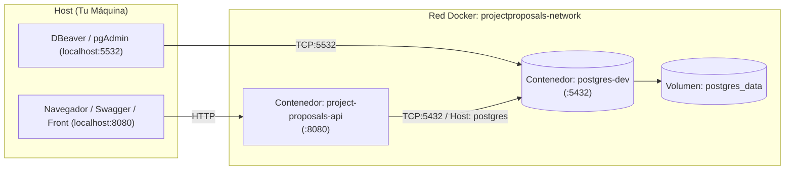

# Guía de Orquestación Docker - Project Proposals Backend & PostgreSQL 18

Este directorio contiene la infraestructura declarativa completa para desplegar todo el backend institucional en contenedores Docker mediante **Docker Compose**:
- **Backend API:** Web API REST en **.NET 8** (Clean Architecture, CQRS, MediatR, Swagger UI).
- **Base de Datos:** **PostgreSQL 18** optimizado sobre **Alpine Linux** con extensiones de texto (`uuid-ossp`, `pg_trgm`, `unaccent`) y persistencia gestionada.

---

## 1. Estructura del Directorio

```text
Docker/
├── .NET/
│   └── Dockerfile               # Dockerfile multi-stage con cacheo de capas NuGet para la API .NET 8
├── Postgre/
│   └── Dockerfile               # Imagen personalizada de PostgreSQL 18 sobre Alpine Linux
├── init-scripts/
│   ├── 01-init.sql              # Habilitación de extensiones nativas (UUID, Trigram, Unaccent)
│   └── 02-migrations.sql        # Esquema DDL, tablas, índices, secuencias y seed data inicial de EF Core
├── docker-compose.yml           # Orquestación de servicios (API + PostgreSQL), redes y volúmenes
├── DockerRun.txt                # Comando directo de conveniencia para PowerShell (docker run)
└── README.md                    # Documentación técnica completa (este archivo)
```

---

## 2. Arquitectura de los Servicios



### 2.1 Servicio `postgres`
- **Imagen:** `postgres-custom:18-alpine` compilada desde [Postgre/Dockerfile](file:///d:/Projects/ProjectProposals_backend/Docker/Postgre/Dockerfile).
- **Contenedor:** `postgres-dev`.
- **Mapeo de Puertos (`5532:5432`):**
  - Expone el motor en el puerto **`5532`** del host para evitar colisiones con instancias locales de PostgreSQL que ocupen el puerto estándar `5432`.
  - Internamente dentro de la red Docker siempre escucha en el puerto `5432`.
- **Credenciales y Configuración:**
  - `POSTGRES_USER`: `maxxi`
  - `POSTGRES_PASSWORD`: `MiClaveLocal123`
  - `POSTGRES_DB`: `projectapproval`
  - `PGDATA`: `/var/lib/postgresql/data/pgdata`
- **Monitoreo de Salud (`Healthcheck`):** Comprueba cada 5s con `pg_isready` si el motor está listo para aceptar consultas reales.
- **Persistencia:** Volumen administrado con nombre `postgres_data` montado en `/var/lib/postgresql/data`.
- **Scripts de Inicialización:** Montados en `/docker-entrypoint-initdb.d/`. Al crear un volumen nuevo, se ejecutan en orden:
  1. `01-init.sql`: Activa extensiones `uuid-ossp`, `pg_trgm` y `unaccent`.
  2. `02-migrations.sql`: Genera el DDL completo, claves foráneas, secuencias y datos iniciales de catálogo.

### 2.2 Servicio `api`
- **Imagen:** `project-proposals-api:latest` compilada desde [.NET/Dockerfile](file:///d:/Projects/ProjectProposals_backend/Docker/.NET/Dockerfile).
- **Contenedor:** `project-proposals-api`.
- **Mapeo de Puertos (`8080:8080`):** Expone la API REST y Swagger en `http://localhost:8080`.
- **Sincronización:** Configurado con `depends_on` con condición `service_healthy`. El contenedor de la API espera automáticamente a que PostgreSQL complete su inicialización y esté listo.
- **Migraciones Automáticas de EF Core:** Al iniciar, la aplicación ejecuta `context.Database.Migrate()` en [Program.cs](file:///d:/Projects/ProjectProposals_backend/ProjectApproval.Api/Program.cs), sincronizando cualquier migración pendiente en la tabla `__EFMigrationsHistory`.
- **Variables de Entorno Clave:**
  - `ASPNETCORE_ENVIRONMENT`: `Development` (habilita la interfaz interactiva de Swagger UI).
  - `ASPNETCORE_HTTP_PORTS`: `8080`
  - `ConnectionStrings__LocalProjectConnection`: `Host=postgres;Port=5432;Database=projectapproval;Username=maxxi;Password=MiClaveLocal123;Include Error Detail=true;Trust Server Certificate=true;`

---

## 3. Comandos de Uso

Los comandos pueden ejecutarse tanto desde el directorio raíz del repositorio como desde la carpeta `Docker/`:

### 3.1 Construir y Levantar Todo el Entorno
```powershell
docker compose up -d --build
```
> [!NOTE]
> La primera vez Docker compilará ambas imágenes. Las ejecuciones posteriores serán casi instantáneas gracias al caché de capas.

### 3.2 Verificar el Estado de los Contenedores
```powershell
docker compose ps
```
Deberás ver ambos contenedores en estado `Up` y PostgreSQL marcado como `(healthy)`.

### 3.3 Ver Logs en Tiempo Real
```powershell
# Ver logs unificados de ambos servicios
docker compose logs -f

# Ver exclusivamente logs de la API .NET
docker compose logs -f api

# Ver exclusivamente logs del motor PostgreSQL
docker compose logs -f postgres
```

### 3.4 Detener los Servicios
```powershell
# Detener contenedores sin perder ningún dato
docker compose stop

# Iniciar nuevamente los contenedores detenidos
docker compose start

# Detener y remover contenedores y redes (los datos persisten en postgres_data)
docker compose down
```

### 3.5 Reinicio Total desde Cero (Reset de Base de Datos)
> [!CAUTION]
> El siguiente comando destruye permanentemente el volumen `postgres_data`. Al levantar nuevamente se ejecutarán los scripts de inicialización desde cero:

```powershell
# Detener y eliminar volúmenes
docker compose down -v

# Reconstruir y levantar con base de datos limpia
docker compose up -d --build
```

---

## 4. Acceso y Pruebas Rápidas

### 4.1 Documentación Interactiva (Swagger UI)
Una vez levantado el entorno, abre tu navegador en:
[http://localhost:8080/swagger](http://localhost:8080/swagger)

### 4.2 Probar Login con Usuario Semilla
El sistema viene pre-poblado con usuarios de prueba. Puedes autenticarte enviando:

- **Endpoint:** `POST http://localhost:8080/api/Auth/login`
- **Headers:** `Content-Type: application/json`
- **Body:**
```json
{
  "email": "jferreyra@unaj.com",
  "password": "Password123!"
}
```

**Ejemplo en PowerShell:**
```powershell
$body = @{
    email = "jferreyra@unaj.com"
    password = "Password123!"
} | ConvertTo-Json

Invoke-RestMethod -Uri "http://localhost:8080/api/Auth/login" -Method Post -ContentType "application/json" -Body $body
```

**Respuesta esperada:**
```json
{
  "accessToken": "eyJhbGciOi...",
  "refreshToken": "4mlUa-khwt...",
  "tokenType": "Bearer",
  "expiresIn": 900,
  "user": {
    "id": 1,
    "name": "José Ferreyra",
    "email": "jferreyra@unaj.com",
    "role": {
      "id": 2,
      "name": "Gerente"
    }
  }
}
```

---

## 5. Cadenas de Conexión (Connection Strings)

### Para herramientas en el Host (DBeaver, pgAdmin, Visual Studio local):
Usa el puerto mapeado **`5532`**:
```text
Host=localhost;Port=5532;Database=projectapproval;Username=maxxi;Password=MiClaveLocal123;Include Error Detail=true;Trust Server Certificate=true;
```

### Para el contenedor dentro de la red Docker (`projectproposals-network`):
Usa el nombre del servicio **`postgres`** y puerto interno **`5432`**:
```text
Host=postgres;Port=5432;Database=projectapproval;Username=maxxi;Password=MiClaveLocal123;Include Error Detail=true;Trust Server Certificate=true;
```

---

## 6. Acceso a la Consola Interactiva de PostgreSQL (`psql`)

Puedes ingresar directamente a la consola de base de datos sin instalar herramientas adicionales en Windows:

```powershell
docker exec -it postgres-dev psql -U maxxi -d projectapproval
```

Comandos útiles dentro de `psql`:
- `\dt` : Listar todas las tablas creadas.
- `\dx` : Listar extensiones activas (`uuid-ossp`, `pg_trgm`, `unaccent`).
- `SELECT * FROM "User";` : Consultar usuarios precargados.
- `\q` : Salir de psql.
