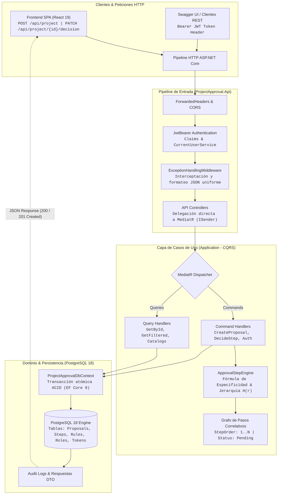
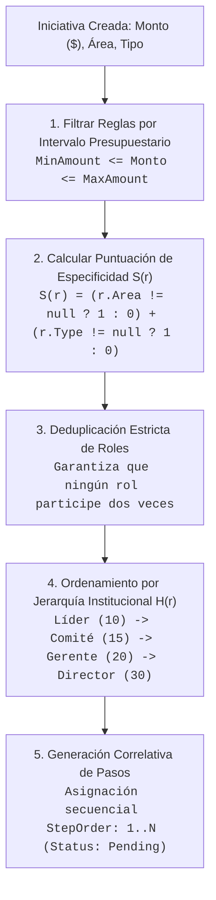
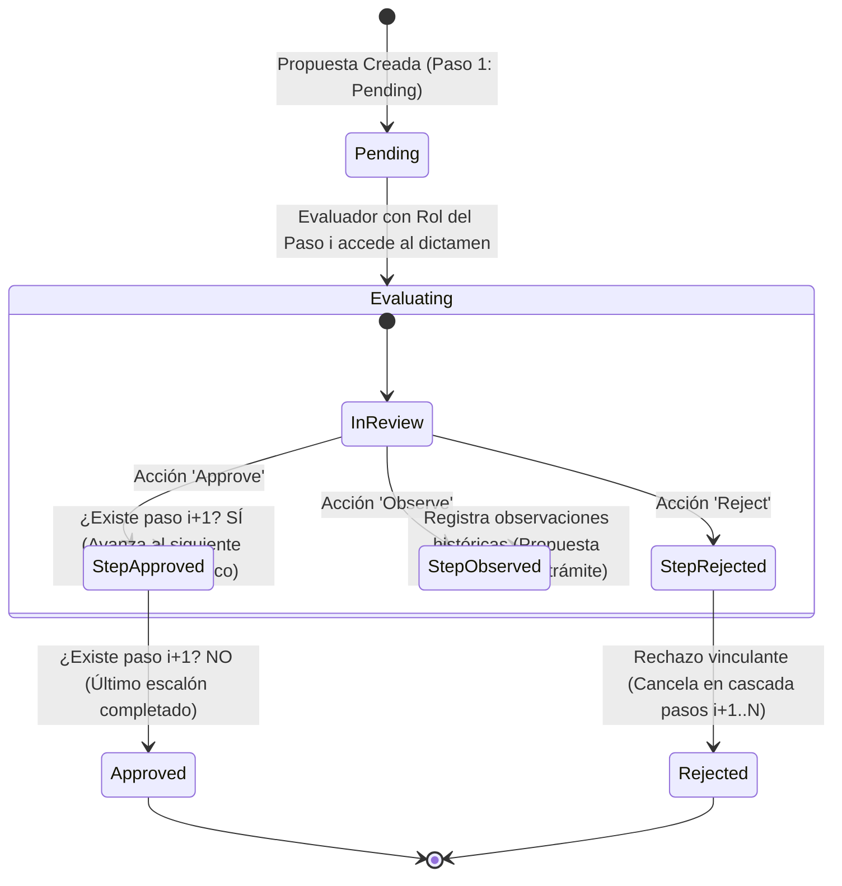

# Project Proposals Engine & Web API

> Motor backend de alta fidelidad para la evaluación, auditoría y orquestación determinista de flujos de aprobación jerárquica en propuestas de proyectos.

[](https://dotnet.microsoft.com/)
[](https://docs.microsoft.com/dotnet/csharp/)
[](https://learn.microsoft.com/ef/core/)
[](https://www.postgresql.org/)
[](https://github.com/jbogard/MediatR)
[](https://automapper.org/)
[](https://github.com/BcryptNet/bcrypt.net)
[](https://www.docker.com/)
[](https://xunit.net/)

[Documentación Completa de la API (API_DOCUMENTATION.md)](./API_DOCUMENTATION.md) · [Swagger UI (Local)](http://localhost:8080/swagger)

---

## Características Principales

* **Motor de Reglas Jerárquicas (`ApprovalStepEngine`):** Evaluación en microsegundos de umbrales presupuestarios (`[MinAmount, MaxAmount]`), especificidad por área/tipo de proyecto, deduplicación estricta de roles y ordenamiento determinista por nivel jerárquico organizacional (`HierarchyLevel`).
* **Máquina de Estados de Decisión y Control Concurrente:** Ciclo determinista secuencial sin saltos de etapa; aprobación correlativa paso a paso, retroalimentación con observaciones históricas (`Observed`) o cancelación en cascada con cierre definitivo en caso de rechazo (`Rejected`).
* **Autenticación Criptográfica & Rotación de Refresh Tokens:** Control de acceso basado en roles (RBAC) con tokens Bearer HMAC-SHA256 (15 min), Refresh Tokens de 7 días con rotación automática y detección preventiva de reúso fraudulento con revocación masiva de sesiones.
* **Arquitectura CQRS con MediatR:** Segregación estricta entre comandos mutacionales (`Commands`) y consultas optimizadas de solo lectura (`Queries`), garantizando clases delgadas, desacopladas y de responsabilidad única (SRP).
* **Manejo Centralizado de Excepciones:** Middleware interceptor global (`ExceptionHandlingMiddleware`) que mapea excepciones de dominio tipadas (`NotFoundException`, `BadRequestException`, `ConflictException`) a respuestas JSON homogéneas con códigos HTTP estándar (404, 400, 409, 500).
* **Persistencia Relacional & Migraciones Automáticas:** PostgreSQL 18 sobre Alpine Linux con extensiones nativas (`uuid-ossp`, `pg_trgm`, `unaccent`) y sincronización automática del esquema relacional en el arranque mediante `Database.Migrate()`.
* **Compatibilidad Nativa con Reverse Proxies:** Pipeline configurado con `ForwardedHeadersOptions` en Kestrel para preservar esquema HTTPS, cabeceras originales y direcciones IP de clientes detrás de balanceadores como Nginx, Caddy o Cloudflare.
* **Suite Automatizada de Pruebas Unitarias:** Cobertura de la lógica de negocio y cálculo de pasos con xUnit, Moq y FluentAssertions, verificando escenarios límite, especificidad de reglas y prevención de doble decisión.

---

## Arquitectura & Dinámica del Sistema



---

### Algoritmo de Resolución de Pasos (`ApprovalStepEngine`)

El motor resuelve la complejidad de transformar las variables de una iniciativa (monto estimado, área postulante, clasificación técnica) en una **cadena secuencial finita, no redundante y jerárquicamente ordenada de decisiones humanas auditables**.



#### Reglas de Ejecución:
1. **Filtrado Presupuestario y de Compatibilidad:**  
   Se seleccionan las reglas activas cuyo intervalo $[\text{MinAmount}, \text{MaxAmount}]$ contenga al monto estimado de la iniciativa, descartando reglas de área o tipo que discrepen explícitamente con los datos de la propuesta.
2. **Puntuación de Especificidad de Regla:**  
   Para resolver solapamientos entre reglas concurrentes, se pondera la especificidad $S(r)$ priorizando reglas con criterio exacto de área y tipo sobre reglas genéricas:
   $$S(r) = (r.\text{AreaId} \neq \text{null} \ ? \ 1 : 0) + (r.\text{ProjectTypeId} \neq \text{null} \ ? \ 1 : 0)$$
   En caso de empate en $S(r)$, se resuelve de manera determinista mediante el identificador unívoco de la regla.
3. **Deduplicación & Ordenamiento Jerárquico:**  
   Se eliminan roles duplicados para que ningún rol vote más de una vez en la misma propuesta, ordenándolos de menor a mayor jerarquía institucional según `HierarchyLevel`:
   * **Nivel 10:** Líder de Área (*Revisión inicial del sector*).
   * **Nivel 15:** Comité Técnico (*Viabilidad técnica e infraestructura*).
   * **Nivel 20:** Gerente (*Factibilidad financiera y asignación*).
   * **Nivel 30:** Director (*Dictamen vinculante de máxima jerarquía*).
4. **Asignación Correlativa Sin Huecos:**  
   Los roles ordenados se asignan a pasos correlativos con índice secuencial estricto ($1, 2, \dots, n$) en estado inicial `Pending`.

---

### Máquina de Estados del Ciclo de Dictamen

Cada propuesta atraviesa un ciclo determinista de cambios de estado auditado por `DecideApprovalStepCommandHandler`:



* **Validación de Identidad y Rol:** El sistema comprueba mediante el token JWT que el usuario autenticado ostente exactamente el rol requerido para el paso en curso.
* **Idempotencia y Bloqueo de Secuencia:** Intentar decidir un paso ya concluido arroja `ConflictException` (409). Intentar decidir un paso adelantado sin haber completado los anteriores arroja `BadRequestException` (400).

---

## Catálogo de Contratos & Endpoints Principales

Todos los endpoints protegidos requieren la cabecera estándar `Authorization: Bearer <accessToken>`.

### 1. Autenticación (`/api/auth`)

* **`POST /api/auth/login`** — Inicia sesión y genera el par de tokens criptográficos.
  * *Request Payload:*
    ```json
    {
      "email": "jferreyra@unaj.com",
      "password": "Password123!"
    }
    ```
  * *Response (200 OK):*
    ```json
    {
      "accessToken": "eyJhbGciOiJIUzI1NiIsInR5cCI6IkpXVCJ9...",
      "refreshToken": "xH4n9L2qW-7mP1kR8vT0yA...",
      "tokenType": "Bearer",
      "expiresIn": 900,
      "user": {
        "id": 1,
        "name": "José Ferreyra",
        "email": "jferreyra@unaj.com",
        "role": { "id": 2, "name": "Gerente" }
      }
    }
    ```

* **`POST /api/auth/refresh-token`** — Renueva el Access Token y rota el Refresh Token.
  * *Request Payload:*
    ```json
    {
      "refreshToken": "xH4n9L2qW-7mP1kR8vT0yA..."
    }
    ```

* **`POST /api/auth/revoke-token`** `[Authorize]` — Cierra la sesión activa revocando el Refresh Token.

---

### 2. Gestión de Propuestas (`/api/project`)

* **`POST /api/project`** `[Authorize]` — Formula una nueva iniciativa y genera sus pasos correlativos.
  * *Request Payload:*
    ```json
    {
      "title": "Modernización de Servidores Centrales",
      "description": "Adquisición de infraestructura de cómputo para laboratorios.",
      "estimatedAmount": 4500000.00,
      "estimatedDuration": 6,
      "area": 1,
      "type": 2,
      "user": 1
    }
    ```
  * *Response (201 Created):* Devuelve la entidad completa con su `id` (GUID) y el arreglo `steps` ordenado jerárquicamente.

* **`GET /api/project/{id}`** `[Authorize]` — Consulta el detalle de una propuesta con todo su historial de dictámenes.

* **`GET /api/project/rolepending/{roleId}`** `[Authorize]` — Obtiene las propuestas que se encuentran esperando dictamen del rol especificado.

* **`PATCH /api/project/{id}/decision`** `[Authorize]` — Registra un dictamen vinculante sobre el paso activo.
  * *Request Payload:*
    ```json
    {
      "action": "Approve",
      "observations": "Se aprueba la partida presupuestaria conforme a los fondos disponibles."
    }
    ```
  * *Valores válidos para `action`:* `"Approve"`, `"Reject"`, `"Observe"`.

---

### 3. Esquema Estandarizado de Errores

Todas las excepciones de la aplicación devuelven un formato uniforme interceptado por el middleware global:

```json
{
  "message": "Descripción clara del motivo del rechazo o conflicto."
}
```

| Código HTTP | Excepción de Dominio | Causa Típica |
| :---: | :--- | :--- |
| **400 Bad Request** | `BadRequestException` | Campos inválidos o intento de decidir un paso sin completar el paso anterior. |
| **401 Unauthorized** | N/A | Token ausente, expirado o firma inválida. |
| **403 Forbidden** | N/A | El usuario autenticado no ostenta el rol requerido para dictaminar el paso activo. |
| **404 Not Found** | `NotFoundException` | La propuesta, usuario o recurso solicitado no existe en la base de datos. |
| **409 Conflict** | `ConflictException` | Intento de registrar un dictamen sobre un paso que ya fue decidido previamente. |
| **500 Server Error** | `Exception` | Error no controlado atrapado y registrado de forma segura. |

---

## Modelo de Dominio & Entidades Relacionales

El esquema en PostgreSQL 18 está estructurado en base a las siguientes entidades nucleares:

| Entidad | Tabla | Propósito y Relaciones Clave |
| :--- | :--- | :--- |
| **`ProjectProposal`** | `ProjectProposals` | Raíz de agregado. Almacena título, descripción, monto estimado, duración, estado actual y claves foráneas hacia `Area`, `ProjectType`, `ApprovalStatus` y `User` (creador). Contiene la colección `Steps`. |
| **`ProjectApprovalStep`** | `ProjectApprovalSteps` | Paso secuencial de aprobación. Clave compuesta o foránea a `ProjectProposalId`, `ApproverRoleId`, `ApproverUserId` (auditor), `StepOrder` (1..N), `DecisionDate`, `Observations` y `Status`. |
| **`ApprovalRule`** | `ApprovalRules` | Regla institucional configurada. Define rangos `[MinAmount, MaxAmount]`, `StepOrder`, `ApproverRoleId`, y criterios opcionales de filtro por `Area` y `ProjectType`. |
| **`ApproverRole`** | `ApproverRoles` | Roles organizacionales del sistema. Incluye `HierarchyLevel` (10, 15, 20, 30) e indicador `IsSpecializedRole`. |
| **`User`** | `Users` | Usuario institucional. Contiene `Name`, `Email`, `PasswordHash` (BCrypt) y rol asignado. |
| **`RefreshToken`** | `RefreshTokens` | Registro de tokens de refresco. Contiene el token criptográfico, fechas de emisión/expiración, `RevokedAt` y puntero `ReplacedByToken` para detección de reúso. |

---

## Entorno de Ejecución & Puesta en Marcha

### Requisitos Previos
* **.NET 8 SDK:** Versión `8.0.100` o superior instalada (para compilación local).
* **Docker & Docker Compose v2:** Recomendado para aprovisionamiento rápido y aislado.
* **Git:** Para control de versiones.
* *(Opcional)* Cliente PostgreSQL (DBeaver, pgAdmin) para inspección directa de datos.

---

### Configuración de Variables de Entorno

Copia la plantilla de variables de entorno y ajusta los valores necesarios:

```bash
# En Linux / macOS / Git Bash
cp .env.example .env

# En Windows PowerShell
Copy-Item .env.example .env
```

| Variable | Descripción | Valor por Defecto Local |
| :--- | :--- | :--- |
| `POSTGRES_USER` | Superusuario administrador de PostgreSQL | `maxxi` |
| `POSTGRES_PASSWORD` | Contraseña del superusuario | `MiClaveLocal123` |
| `POSTGRES_DB` | Nombre de la base de datos relacional | `projectapproval` |
| `DB_PORT_BINDING` | Interfaz y puerto del host para PostgreSQL | `127.0.0.1:5532` |
| `API_PORT_BINDING` | Interfaz y puerto del host para la API | `127.0.0.1:8080` |
| `ASPNETCORE_ENVIRONMENT` | Entorno de ejecución (`Development` / `Production`) | `Development` |
| `JWT_SECRET_KEY` | Clave secreta simétrica HMAC-SHA256 (mín. 32 caracteres) | Preconfigurada para dev |
| `JWT_ISSUER` | Emisor del token JWT | `ProjectProposalsApi` |
| `JWT_AUDIENCE` | Audiencia del token JWT | `ProjectProposalsClient` |
| `JWT_ACCESS_EXPIRATION_MINUTES` | Duración del token de acceso (en minutos) | `15` |
| `JWT_REFRESH_EXPIRATION_DAYS` | Duración del refresh token (en días) | `7` |
| `ENABLE_SWAGGER` | Habilita Swagger UI en el pipeline | `true` |

---

### Instalación y Ejecución

#### Opción A: Con Docker Compose (Recomendado)

```bash
# 1. Construir las imágenes y levantar contenedores en segundo plano
docker compose up -d --build

# 2. Verificar el estado de salud de los servicios
docker compose ps

# 3. Monitorear los logs de compilación y migraciones automáticas
docker compose logs -f api
```

Los servicios quedarán disponibles en:
* **Swagger UI:** [http://localhost:8080/swagger](http://localhost:8080/swagger)
* **PostgreSQL (Host):** `localhost:5532` (Usuario: `maxxi`, Clave: `MiClaveLocal123`, DB: `projectapproval`)

---

#### Opción B: Ejecución Nativa con .NET CLI (Sin Docker)

Si dispones de una instancia local de PostgreSQL activa:

1. Configura la cadena de conexión en `ProjectApproval.Api/appsettings.json`:
   ```json
   "ConnectionStrings": {
     "LocalProjectConnection": "Host=localhost;Port=5432;Database=projectapproval;Username=postgres;Password=tu_clave;"
   }
   ```
2. Restaura paquetes y compila la solución:
   ```bash
   dotnet restore ProjectApproval.sln
   dotnet build ProjectApproval.sln
   ```
3. Ejecuta la API:
   ```bash
   dotnet run --project ProjectApproval.Api
   ```
   *La API iniciará en `http://localhost:5242` y `https://localhost:7084` con Swagger habilitado.*

---

### Scripts Disponibles

```bash
# Compilación y Ejecución (.NET CLI)
dotnet build ProjectApproval.sln                     # Compila la solución completa
dotnet run --project ProjectApproval.Api             # Inicia la API en modo desarrollo
dotnet publish ProjectApproval.Api -c Release -o ./publish /p:UseAppHost=false # Publicación optimizada

# Pruebas Unitarias
dotnet test Application.UnitTests/Application.UnitTests.csproj --logger "console;verbosity=detailed"

# Docker Compose
docker compose up -d --build                         # Construye y levanta PostgreSQL y API
docker compose down                                  # Detiene los contenedores preservando volúmenes
docker compose down -v                               # Detiene los contenedores y destruye volúmenes de datos
docker compose logs -f api                           # Visualiza los registros en tiempo real de la API
```

---

## Cuentas de Acceso Preconfiguradas (Seed Data)

Todos los usuarios del seed inicial comparten la misma contraseña maestra para facilitar pruebas:
> **Contraseña común:** `Password123!`

| ID | Nombre | Correo Electrónico | Rol Aprobador | Nivel Jerárquico |
| :---: | :--- | :--- | :--- | :---: |
| **1** | José Ferreyra | `jferreyra@unaj.com` | Gerente | Nivel 3 (20) |
| **2** | Ana Lucero | `alucero@unaj.com` | Líder de Área | Nivel 1 (10) |
| **3** | Gonzalo Molinas | `gmolinas@unaj.com` | Gerente | Nivel 3 (20) |
| **4** | Lucas Olivera | `lolivera@unaj.com` | Director | Nivel 4 (30) |
| **5** | Danilo Fagundez | `dfagundez@unaj.com` | Comité Técnico | Nivel 2 (15) |
| **6** | Gabriel Galli | `ggalli@unaj.com` | Comité Técnico | Nivel 2 (15) |
| **7** | Mariana Torres | `mtorres@unaj.com` | Líder de Área | Nivel 1 (10) |
| **8** | Carlos Mendoza | `cmendoza@unaj.com` | Director | Nivel 4 (30) |

---

## Stack Tecnológico

* **Core & Runtime:** .NET 8.0 SDK / Runtime (`net8.0`), C# 12.0, ASP.NET Core Web API 8 (`8.0.x`).
* **Arquitectura & Patrones:** Clean Architecture, Domain-Driven Design (DDD táctico), CQRS con MediatR `14.2.0`, AutoMapper `16.2.0`.
* **Persistencia & ORM:** PostgreSQL 18 (`18-alpine`), Entity Framework Core `9.0.5` (`Microsoft.EntityFrameworkCore.Design 9.0.5`, `Microsoft.EntityFrameworkCore.Tools 9.0.5`), Npgsql EF Core Provider `9.0.4`.
* **Seguridad & Autenticación:** `Microsoft.AspNetCore.Authentication.JwtBearer 8.0.13` (HMAC-SHA256, 15 min), `System.IdentityModel.Tokens.Jwt 7.1.2`, BCrypt.Net-Next `4.0.3` (costo 11), Refresh Tokens criptográficos de 64 bytes (7 días).
* **Testing & Calidad:** xUnit `2.5.3` (runner `2.5.3`), Moq `4.21.0`, FluentAssertions `8.11.0`, `Microsoft.NET.Test.Sdk 17.8.0`, `coverlet.collector 6.0.0`.
* **Documentación & Tooling:** OpenAPI 3.0 / Swagger UI (Swashbuckle.AspNetCore `6.6.2`).
* **DevOps & Contenerización:** Docker Multi-stage Build (`mcr.microsoft.com/dotnet/sdk:8.0` / `mcr.microsoft.com/dotnet/aspnet:8.0`), Docker Compose v2.

---

## Decisiones de Arquitectura & Trade-offs

1. **Clean Architecture Estricta:** El núcleo de negocio ([Domain](./Domain)) y los casos de uso ([Application](./Application)) son completamente agnósticos de frameworks externos y de la base de datos. Si se migra el motor de persistencia, las reglas del negocio no sufren modificaciones.
2. **CQRS con Handlers Atómicos:** Frente a servicios multipropósito tradicionales con docenas de métodos, cada caso de uso se modela en un comando o consulta independiente (`CreateProjectProposalCommand`, `DecideApprovalStepCommand`), eliminando efectos colaterales.
3. **Motor de Reglas Compilado en Memoria:** En lugar de incorporar motores pesados de workflow (Camunda, Elsa), `ApprovalStepEngine` resuelve dependencias presupuestarias y jerárquicas en microsegundos con 100% de cobertura en tests unitarios puros.
4. **Terminación SSL Externa con Forwarded Headers:** Kestrel atiende tráfico HTTP en el puerto interno `8080`, mientras que un Reverse Proxy (Nginx, Caddy o Cloudflare) gestiona los certificados SSL/TLS con Let's Encrypt. `ForwardedHeadersOptions` en `Program.cs` asegura que los esquemas y las IPs de los clientes se preserven sin generar bucles de redirección.

---

