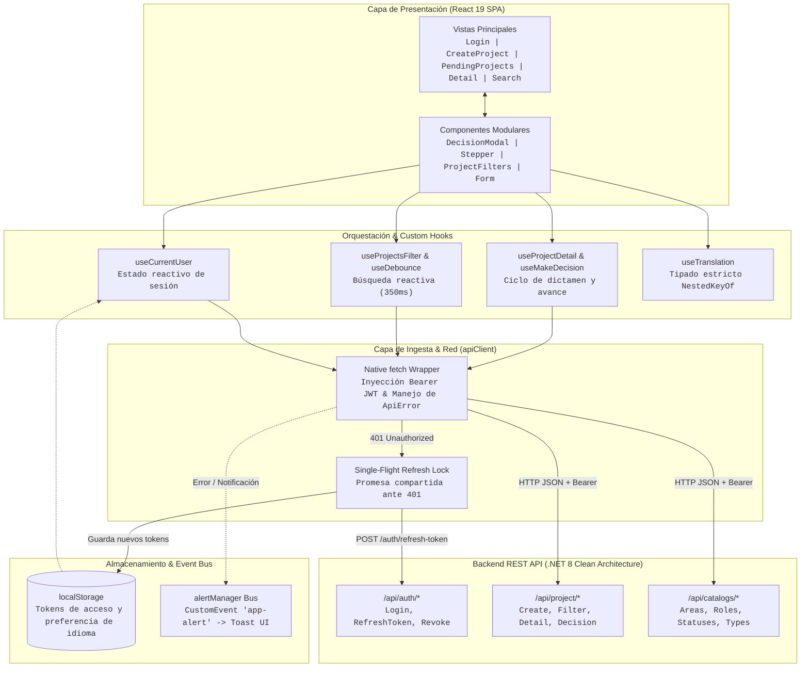

# Project Manager — Client Application (React 19)

> Plataforma web de gobernanza institucional para la formulación, seguimiento y dictamen colegiado de propuestas de proyectos mediante flujos de aprobación secuenciales por roles (RBAC).

[](https://react.dev/)
[](https://www.typescriptlang.org/)
[](https://vitejs.dev/)
[](https://reactrouter.com/)
[](https://react-icons.github.io/react-icons/)
[](https://github.com/css-modules/css-modules)
[](https://firebase.google.com/)
[](https://eslint.org/)
[](https://dotnet.microsoft.com/)

[Especificación de Producto (PRODUCT.md)](./PRODUCT.md) · [Documentación de la API (Backend)](../ProjectProposals_backend/API_DOCUMENTATION.md)

---

## Características Principales

* **Autenticación RBAC & Selector Demo Rápido:** Inicio de sesión seguro con JWT Bearer y Refresh Token tradicional, panel interactivo con credenciales precargadas para perfiles de la UNAJ (*Director*, *Gerente*, *Líder de Área*, *Comité Técnico*) y rutas protegidas con `ProtectedRoute`.
* **Gobernanza Escalonada & Stepper Cronológico:** Visualización en tiempo real del progreso de evaluación por etapas, identificación instantánea del rol habilitado para dictaminar y modal de decisión vinculante con captura de observaciones técnicas (Aprobado, Rechazado u Observado).
* **Tablero Ejecutivo de Iniciativas (KPIs):** Panel de control con métricas en tiempo real de iniciativas en trámite, acciones prioritarias pendientes para el rol activo y volumen presupuestario acumulado.
* **Buscador Reactivo Multidimensional con Debounce:** Filtrado simultáneo por título, estado de aprobación, usuario solicitante y evaluador asignado, optimizado mediante el hook `useDebounce` (350 ms) para minimizar peticiones de red innecesarias.
* **Formulación Estructurada de Nuevas Propuestas:** Registro guiado de proyectos con validación preventiva en cliente de presupuesto financiero, plazo estimado en meses, área de impacto y tipología antes de impactar el servidor.
* **Refresco Concurrente de Tokens (Single-Flight):** Interceptor HTTP que captura errores 401 y resuelve la renovación de credenciales mediante una única promesa compartida, eliminando condiciones de carrera y la invalidación accidental de Refresh Tokens.
* **Internacionalización Nativa Trilingüe (Zero-Dependency):** Motor i18n propio con soporte para Español (`es`), Inglés (`en`) y Portugués (`pt`), con verificación estricta de claves anidadas en tiempo de compilación (`NestedKeyOf<TranslationSchema>`) sin cargar librerías externas.
* **Arquitectura Visual Modular con CSS Modules (Tailwind-Free):** Aislamiento estricto de estilos por componente en archivos `*.module.css` (convención `camelCase`), tokens visuales HSL corporativos, tipografía `Inter` y rendimiento fluido a 60 FPS sin sobrecarga de runtime.
* **Bus de Notificaciones Desacoplado:** Sistema de alertas Toast operado mediante eventos nativos del DOM (`CustomEvent`), permitiendo despachar avisos desde hooks o servicios sin incurrir en prop drilling.

---

## Flujo de Datos & Arquitectura del Cliente



---

### 1. Manejo Concurrente de Expiración de Token (Single-Flight)

En vistas con carga paralela de recursos (ej. detalle del proyecto cargando catálogos y estados simultáneamente), el vencimiento del token provocaría múltiples solicitudes de renovación concurrentes, invalidando el Refresh Token por reuso no sincronizado.

Para resolver esto, `apiClient.ts` implementa un cerrojo asíncrono con promesa única compartida:

```typescript
// Fragmento representativo en src/api/client.ts
let refreshPromise: Promise<string | null> | null = null;

if (response.status === 401 && !options?._retry && !isAuthEndpoint) {
    if (!refreshPromise) {
        refreshPromise = executeRefreshToken(baseUrl).finally(() => {
            refreshPromise = null;
        });
    }

    const newAccessToken = await refreshPromise;
    if (newAccessToken) {
        return apiClient<T>(cleanEndpoint, {
            ...options,
            _retry: true,
            headers: { ...headers, Authorization: `Bearer ${newAccessToken}` },
        });
    }

    clearAuthSession();
    throw new ApiError("Session expired. Please log in again.", 401);
}
```

Todas las solicitudes concurrentes quedan a la espera de la resolución del mismo `refreshPromise` y se reintentan de forma transparente con el nuevo token obtenido.

---

### 2. Ciclo de Dictamen y Avance de Etapas

1. **Consulta de Iniciativas:** El evaluador accede a su tablero y el hook `usePendingProjects` invoca `GET /api/project/rolepending/{roleId}`.
2. **Evaluación de Etapa:** Al ingresar al detalle de la propuesta, se despliega el stepper visual cronológico generado a partir de `approvalSteps`. El hook identifica automáticamente si el paso activo coincide con los permisos del evaluador autenticado.
3. **Emisión de Dictamen:** El evaluador abre `DecisionModal`, selecciona la acción (*Aprobar*, *Observar* o *Rechazar*) e ingresa sus comentarios técnicos.
4. **Mutación de Estado:** Se despacha `PATCH /api/project/{id}/decision`. La API valida la secuencia, avanza el workflow al siguiente escalón y el frontend actualiza la interfaz y notifica el resultado mediante el bus de alertas Toast.

---

### 3. Pipeline de Búsqueda Reactiva con Debounce

En `ProjectsSearchPage`, el hook `useDebounce` amortigua las entradas del usuario en los campos de filtro:

$$\text{Delay} = 350\text{ ms}$$

Solo cuando el usuario detiene la escritura durante dicho intervalo se actualiza el estado y se despacha `GET /api/project` con los parámetros serializados en la URL, reduciendo drásticamente el consumo de recursos en el servidor.

---

## Rutas y Navegación SPA

La topología de rutas está gestionada de forma declarativa mediante `AppRouter.tsx` y `ProtectedRoute.tsx`:

| Ruta | Componente / Vista | Acceso | Propósito |
| :--- | :--- | :---: | :--- |
| `/` | `Home` | Público | Pantalla de bienvenida con presentación institucional y accesos directos. |
| `/about` | `About` | Público | Especificación del sistema, misión institucional y roadmap técnico. |
| `/login` | `Login` | Público | Inicio de sesión con formulario y selector de perfiles demo de la UNAJ. |
| `/create-project` | `CreateProject` | `Protegido` | Formulario guiado de formulación de iniciativas con validación preventiva. |
| `/pending-projects`| `PendingProjectsPage` | `Protegido` | Tablero ejecutivo con las iniciativas pendientes que esperan dictamen del rol activo. |
| `/search` | `ProjectsSearchPage` | `Protegido` | Buscador multidimensional con filtros reactivos y debounce. |
| `/project/:id` | `ProjectDetailPage` | `Protegido` | Detalle exhaustivo, stepper cronológico y modal de dictamen vinculante. |
| `*` | `NotFound` | Público | Página 404 para captura de rutas no reconocidas. |

> [!NOTE]
> `ProtectedRoute` inspecciona el estado de autenticación en `useCurrentUser`. Si la sesión no es válida, redirige automáticamente al usuario hacia `/login` preservando la ruta de destino original en `state.from` para retornar tras la autenticación exitosa.

---

## Custom Hooks de Dominio

La lógica de negocio reside estrictamente en hooks desacoplados, aislando los componentes visuales:

* **`useCurrentUser`:** Expone el estado reactivo del usuario en sesión (`user`, `isAuthenticated`), el rol activo y el método `logout()`.
* **`useProjectDetail(id)`:** Gestiona la carga completa de una propuesta por ID, mapea los pasos secuenciales de aprobación y maneja estados de error o reintento.
* **`useMakeDecision(projectId, onDecisionSuccess)`:** Controla la apertura del modal de dictamen, valida las observaciones ingresadas y despacha la mutación `PATCH /api/project/{id}/decision`.
* **`usePendingProjects`:** Consulta las iniciativas asignadas al rol activo del usuario mediante `GET /api/project/rolepending/{roleId}`, calculando indicadores KPI y proyectos prioritarios.
* **`useProjectsFilter`:** Orquesta el filtrado avanzado por título, estado de aprobación, solicitante y evaluador asignado.
* **`useDebounce<T>(value, delay)`:** Hook utilitario genérico que retrasa la actualización de un valor durante el tiempo especificado (350 ms por defecto).
* **`useProjectForm`:** Gestiona el estado y la validación en tiempo real del formulario de formulación de nuevas propuestas.
* **`useTranslation`:** Accede al contexto de internacionalización nativo, ofreciendo funciones tipadas `t(key)` con verificación de claves anidadas en tiempo de compilación.

---

## Validaciones Preventivas en Cliente (`projectValidation.ts`)

Antes de emitir cualquier petición de creación a la API, el cliente aplica las siguientes reglas de negocio:

```typescript
export function validateProjectForm(form: ProjectProposalCreateRequest): FormErrors {
    const errors: FormErrors = {};

    if (!form.title.trim()) errors.title = "Title is required";
    else if (form.title.trim().length > 255) errors.title = "Title cannot exceed 255 characters";

    if (!form.description.trim()) errors.description = "Description is required";
    else if (form.description.trim().length > 255) errors.description = "Description cannot exceed 255 characters";

    if (!Number.isFinite(form.amount) || form.amount <= 0) errors.amount = "Amount must be greater than zero";
    if (!Number.isFinite(form.duration) || form.duration <= 0) errors.duration = "Duration must be greater than zero";
    if (form.area <= 0) errors.area = "Please select an area";
    if (form.type <= 0) errors.type = "Please select a type";
    if (form.user <= 0) errors.user = "Please select an active user";

    return errors;
}
```

---

## Arquitectura de Estilos & Tokens de Diseño

El diseño prescinde deliberadamente de librerías utilitarias pesadas como Tailwind CSS, optando por **Vanilla CSS Modules** con encapsulación nativa a nivel de archivo:

* **Paleta HSL Corporativa:** Variables de diseño en `src/index.css` que garantizan alto contraste y legibilidad ejecutiva (`--primary-color: #2563eb`, `--background-color: #f8fafc`, `--text-color: #0f172a`).
* **Estados Semánticos:** Tokens WCAG AA para estados de éxito (`#059669`), advertencia (`#d97706`), error (`#dc2626`) e información (`#0284c7`).
* **Convención `camelCase`:** Todas las clases CSS se definen en formato camelCase (ej. `.inputContainer`, `.submitButton`) para una integración natural con TypeScript.
* **Rendimiento Óptimo:** Sin procesamiento en tiempo de ejecución, permitiendo animaciones fluidas a 60 FPS y cero fugas de estilos globales.

---

## Instalación y Puesta en Marcha

### Requisitos Previos
* **Node.js:** Versión `20.x` LTS o superior (compatible con Node 22+).
* **Gestor de Paquetes:** `npm` (10+), `pnpm` o `yarn`.
* **Git:** Para control de versiones.
* **Backend Disponible:** Instancia local de la API .NET 8 (puerto `8080` en Docker o `5242` en .NET CLI).

---

### Configuración de Variables de Entorno

Copia el archivo de muestra `.env.example` y genera el archivo local `.env`:

```bash
# En Linux / macOS / Git Bash
cp .env.example .env

# En Windows PowerShell
Copy-Item .env.example .env
```

Configura la variable `VITE_API_BASE_URL` según tu entorno:

```env
VITE_APP_NAME=Project Manager

# Para conectar con el backend local (Docker Compose):
VITE_API_BASE_URL=http://localhost:8080/api

# Para conectar con el backend local (.NET CLI nativo):
# VITE_API_BASE_URL=http://localhost:5242/api
```

---

### Instalación y Ejecución

```bash
# 1. Instalar dependencias del proyecto
npm install

# 2. Iniciar el servidor de desarrollo local con Vite
npm run dev
```

La aplicación quedará disponible inmediatamente en [http://localhost:5173](http://localhost:5173).

---

### Scripts Disponibles

| Comando | Descripción |
| :--- | :--- |
| `npm run dev` | Inicia el servidor de desarrollo local con Hot Module Replacement (HMR) en el puerto `5173`. |
| `npm run build` | Ejecuta la verificación estricta de tipos de TypeScript (`tsc -b`) y compila la SPA optimizada en `dist/`. |
| `npm run lint` | Ejecuta el análisis estático con ESLint 10 y reglas de React Hooks. |
| `npm run preview` | Levanta un servidor local para inspeccionar el bundle de producción compilado en `dist/`. |

---

### Despliegue en Firebase Hosting (Opcional)

El repositorio incluye la configuración de targets y reescritura de rutas SPA en `firebase.json` y `.firebaserc`:

```bash
# 1. Iniciar sesión en Firebase CLI
npx firebase login

# 2. Desplegar al target configurado
npx firebase deploy --only hosting:project-manager
```

---

## Perfiles Demo Preconfigurados

En la pantalla de inicio de sesión (`/login`) se encuentra disponible un selector interactivo con los siguientes perfiles de prueba de la UNAJ:

> **Contraseña común:** `Password123!`

| Nombre | Correo Electrónico | Rol Institucional | Función en el Sistema |
| :--- | :--- | :--- | :--- |
| **José Ferreyra** | `jferreyra@unaj.com` | Gerente | Dictamina en escalones gerenciales |
| **Ana Lucero** | `alucero@unaj.com` | Líder de Área | Dictamina en primeras instancias de área |
| **Gonzalo Molinas** | `gmolinas@unaj.com` | Gerente | Dictamina en escalones gerenciales |
| **Lucas Olivera** | `lolivera@unaj.com` | Director | Dictamen final vinculante institucional |
| **Danilo Fagundez** | `dfagundez@unaj.com` | Comité Técnico | Evaluación de viabilidad técnica |
| **Gabriel Galli** | `ggalli@unaj.com` | Comité Técnico | Evaluación de viabilidad técnica |
| **Mariana Torres** | `mtorres@unaj.com` | Líder de Área | Dictamina en primeras instancias de área |
| **Carlos Mendoza** | `cmendoza@unaj.com` | Director | Dictamen final vinculante institucional |

---

## Stack Tecnológico

* **Frontend & UI:** React 19 (`^19.2.7`, lock `19.2.8`), React DOM 19 (`^19.2.7`, lock `19.2.8`), TypeScript 6 (`~6.0.2`, lock `6.0.3`), Vite 8 (`^8.1.1`, lock `8.1.5`), `@vitejs/plugin-react` (`^6.0.3`).
* **Enrutamiento SPA:** React Router DOM 7 (`^7.18.1`, lock `7.18.4`).
* **Estilos & Diseño:** Vanilla CSS Modules (`*.module.css`), variables de diseño HSL corporativas, React Icons 5 (`^5.7.0`).
* **Cliente HTTP & Red:** Native Fetch Wrapper (`apiClient`) con control tipado de `ApiError` y cerrojo de refresco `Single-Flight`.
* **Internacionalización:** Motor nativo trilingüe (`es`, `en`, `pt`) con tipado estricto en tiempo de compilación (`NestedKeyOf<TranslationSchema>`).
* **Calidad de Código & Linter:** ESLint 10 (`^10.6.0`, lock `10.8.0`), TypeScript-ESLint 8 (`^8.62.0`, lock `8.65.0`), `eslint-plugin-react-hooks` (`^7.1.1`), `eslint-plugin-react-refresh` (`^0.5.3`).
* **Hosting & Distribución:** Firebase Hosting (Google Cloud Edge CDN con SSL administrado).

---

## Decisiones de Ingeniería & Trade-offs

1. **React Hooks Nativos frente a Bibliotecas de Estado Global (Redux / Zustand):**  
   Al tratarse de flujos de datos transaccionales donde la fuente de verdad definitiva reside en el backend relacional, se modeló el estado mediante custom hooks de dominio (`useProjectDetail`, `usePendingProjects`). Esto ahorra 80+ KB de bundle y suprime capas redundantes de sincronización.
2. **Cerrojo Single-Flight para Refresh Tokens:**  
   Cuando expira el Access Token, peticiones paralelas concurrentes podrían detonar múltiples llamadas a `/api/auth/refresh-token`, provocando la invalidación inmediata de la sesión por las reglas de detección de reúso del backend. La promesa compartida `refreshPromise` garantiza que solo se emita una única llamada de red.
3. **Vanilla CSS Modules frente a Tailwind CSS:**  
   Se priorizó la separación semántica de responsabilidades y la eliminación de sobrecarga en tiempo de ejecución. Cada componente encapsula sus estilos en archivos dedicados con nombres hasheados únicos, garantizando cero colisiones de selectores y 60 FPS consistentes.
4. **Capa Explicita de Mappers (DTO vs. Modelos de Dominio):**  
   Los contratos de red (`ProjectResponse`) se desacoplan de las interfaces de interfaz de usuario (`Project`) mediante funciones transformadoras en `src/mappers/`. Si el backend altera formatos de fecha o campos auxiliares, los componentes de la vista no sufren quiebres.
5. **Motor i18n con Tipado Mágico de Claves Anidadas:**  
   Mediante el tipo `NestedKeyOf<TranslationSchema>`, TypeScript valida en tiempo de compilación cada clave de traducción utilizada en la vista (ej. `t("pages.login.passwordLabel")`), ofreciendo autocompletado en el IDE y previniendo errores tipográficos sin añadir librerías externas.
6. **Bus de Alertas Desacoplado con Eventos del DOM:**  
   `alertManager.ts` emite eventos nativos `CustomEvent("app-alert")`, permitiendo que servicios asíncronos y hooks independientes notifiquen al usuario sin requerir inyección de contextos de React en cadenas profundas de componentes.

---

