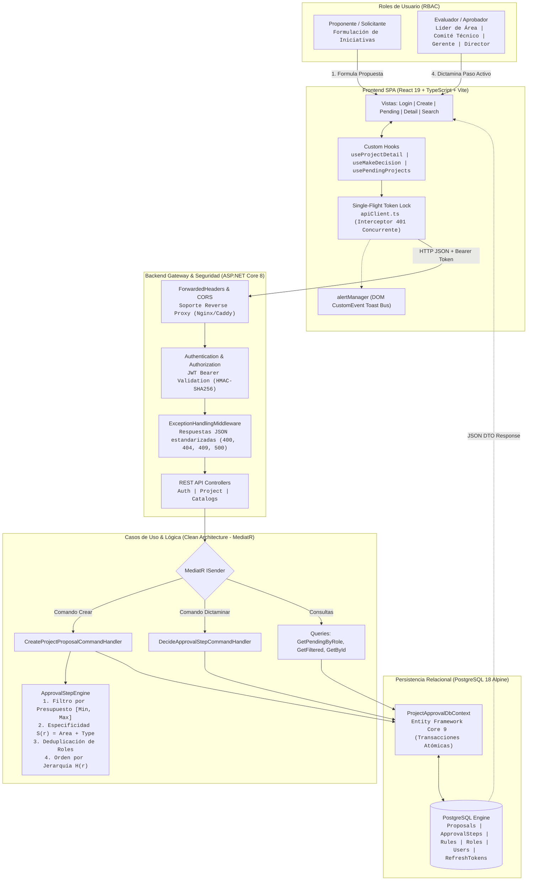
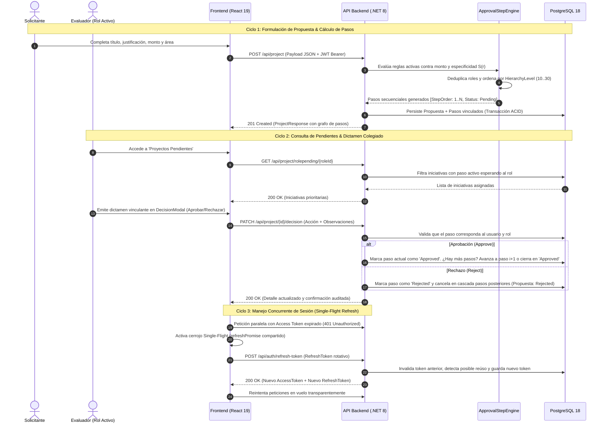

# Project Proposals Management & Governance Ecosystem

> Sistema integral de gestión de proyectos institucionales. Integra un SPA con React 19, un motor transaccional de alta fidelidad en .NET 8 (Clean Architecture, CQRS) y persistencia relacional en PostgreSQL 18.

[](https://react.dev/)
[](https://www.typescriptlang.org/)
[](https://vitejs.dev/)
[](https://reactrouter.com/)
[](https://dotnet.microsoft.com/)
[](https://docs.microsoft.com/dotnet/csharp/)
[](https://learn.microsoft.com/ef/core/)
[](https://www.postgresql.org/)
[](https://github.com/jbogard/MediatR)
[](https://www.docker.com/)
[](https://firebase.google.com/)

[Backend (.NET 8 Clean Architecture)](./ProjectProposals_backend) · [Frontend (React 19 SPA)](./ProjectProposals_frontend_react) · [Catálogo de Endpoints de la API](./ProjectProposals_backend/API_DOCUMENTATION.md) · [Live demo](https://project-manager.maxigimenez.com.ar/)

---

## Visión General & Propósito Institucional

**Project Proposals Ecosystem** resuelve esta problemática centralizando todo el ciclo de vida de una propuesta:
1. **Formulación Estandarizada:** Los miembros de la organización presentan proyectos con presupuesto estimado, plazo, área de impacto y fundamentación técnica.
2. **Generación Determinista de Aprobadores:** El motor de reglas interno calcula automáticamente la cadena de aprobación requerida en base al monto financiero, área y tipología, deduplicando roles y ordenándolos jerárquicamente.
3. **Gobernanza y Dictamen Colegiado:** Los miembros autorizados tienen acceso a la aprobación de iniciativas pendientes en un dashboard exclusivo, con la funcionalidad de emitir dictámenes vinculantes (*Aprobado*, *Rechazado* u *Observado*) con total trazabilidad temporal y firmas auditadas.

---

## Componentes del Ecosistema

| Módulo | Directorio | Tecnología Principal | Rol en la Solución |
| :--- | :--- | :--- | :--- |
| **Backend Engine & API** | [`/ProjectProposals_backend`](./ProjectProposals_backend) | .NET 8.0 (`net8.0`), C# 12, EF Core 9.0.5, PostgreSQL 18-alpine, MediatR 14.2.0, Docker Compose v2 | Núcleo transaccional, motor de reglas (`ApprovalStepEngine`), persistencia relacional y seguridad JWT con rotación de Refresh Tokens. |
| **Frontend Client SPA** | [`/ProjectProposals_frontend_react`](./ProjectProposals_frontend_react) | React 19.2.7 (lock 19.2.8), TypeScript 6.0.2, Vite 8.1.1, React Router 7.18.1, CSS Modules, Firebase | Interfaz de usuario de alta fidelidad, tablero de iniciativas pendientes, stepper de gobernanza, autenticación RBAC con perfiles demo e i18n nativo. |

---

## Flujo de Datos & Gobernanza Integral

El siguiente diagrama detalla la arquitectura de extremo a extremo, mostrando cómo la Single Page Application interactúa con el backend .NET 8 y la base de datos PostgreSQL:



---

### Ciclos Operativos del Sistema



---

## Puesta en Marcha

### Requisitos Previos
* **Docker Desktop / Docker Compose v2:** Para ejecutar el backend y la base de datos PostgreSQL de forma aislada.
* **Node.js:** Versión `20.x` LTS o superior (compatible con Node 22+).
* **Gestor de Paquetes:** `npm` (10+), `pnpm` o `yarn`.
* **Git:** Para control de versiones.
* *(Opcional)* **.NET 8 SDK:** Versión `8.0.100` o superior, requerida únicamente si se desea ejecutar el backend de forma nativa sin Docker.

---

### Configuración de Variables de Entorno

Antes de iniciar, genere los archivos de entorno locales a partir de sus respectivas plantillas:

```bash
# 1. Configurar variables del Backend
cp ProjectProposals_backend/.env.example ProjectProposals_backend/.env

# 2. Configurar variables del Frontend
cp ProjectProposals_frontend_react/.env.example ProjectProposals_frontend_react/.env
```

Ajuste las variables esenciales:
* **Backend (`ProjectProposals_backend/.env`):** Define `POSTGRES_USER`, `POSTGRES_PASSWORD`, `POSTGRES_DB` y `JWT_SECRET_KEY`.
* **Frontend (`ProjectProposals_frontend_react/.env`):** Define `VITE_API_BASE_URL` apuntando a la URL del backend activo (ej. `http://localhost:8080/api` para Docker o `http://localhost:5242/api` para .NET CLI).

---

### Opción 1: Entorno Contenerizado (Docker Compose + Vite) — *Recomendada*

Esta modalidad aprovisiona la base de datos PostgreSQL y la API compilada dentro de la red interna de Docker, mientras el frontend se ejecuta en Node.js local con recarga en caliente (*Hot Module Replacement*).

#### Paso 1: Levantar Backend & Base de Datos con Docker
```bash
# 1. Navegar al backend
cd ProjectProposals_backend

# 2. Levantar servicios en segundo plano
docker compose up -d --build

# 3. Comprobar salud de los contenedores
docker compose ps
```
*La API quedará expuesta en `http://localhost:8080` (Swagger: `http://localhost:8080/swagger`) y PostgreSQL en el puerto `5532`.*

#### Paso 2: Iniciar el Frontend SPA
```bash
# 1. En una nueva terminal, navegar al directorio del frontend
cd ProjectProposals_frontend_react

# 2. Configurar la URL de conexión en .env
# VITE_API_BASE_URL=http://localhost:8080/api

# 3. Instalar dependencias e iniciar el servidor de desarrollo
npm install
npm run dev
```

La aplicación web estará accesible de inmediato en [http://localhost:5173](http://localhost:5173).

---

### Opción 2: Entorno Nativo (.NET CLI + Vite + PostgreSQL)

Para desarrolladores que requieran depuración paso a paso en Visual Studio o VS Code sobre el SDK nativo:

```bash
# 1. Asegurar una instancia de PostgreSQL activa y configurar ConnectionStrings en appsettings.json

# 2. Terminal 1: Compilar e iniciar la API .NET 8
cd ProjectProposals_backend
dotnet restore ProjectApproval.sln
dotnet run --project ProjectApproval.Api

# 3. Terminal 2: Iniciar el cliente React
cd ProjectProposals_frontend_react
# Configurar VITE_API_BASE_URL=http://localhost:5242/api en .env
npm install
npm run dev
```

---

## Topología de Servicios y Puertos Locales

| Servicio | Entorno | URL / Puerto Local | Credenciales por Defecto |
| :--- | :--- | :--- | :--- |
| **Frontend SPA** | React 19 (Vite) | `http://localhost:5173` | Ver tabla de perfiles demo |
| **Backend API (Docker)** | ASP.NET Core 8 | `http://localhost:8080` | Endpoint REST Bearer |
| **Swagger UI (Docker)** | OpenAPI 3.0 | `http://localhost:8080/swagger` | Interactivo con botón Authorize |
| **Backend API (Nativo)** | Kestrel (.NET CLI) | `http://localhost:5242` / `https://localhost:7084` | Endpoint REST Bearer |
| **PostgreSQL 18** | Contenedor Alpine | `localhost:5532` | User: `maxxi`, Pass: `MiClaveLocal123`, DB: `projectapproval` |

---

## Perfiles Demo & Credenciales de Prueba

Ambos proyectos incluyen perfiles precargados para testear todos los niveles del flujo de aprobación colegiado. En la pantalla de inicio de sesión (`/login`) se pueden seleccionar con un solo clic:

> **Contraseña unificada de prueba:** `Password123!`

| ID | Nombre | Correo Electrónico | Rol Institucional | Nivel Jerárquico $H(r)$ | Responsabilidad en el Dictamen |
| :---: | :--- | :--- | :--- | :---: | :--- |
| **1** | José Ferreyra | `jferreyra@unaj.com` | Gerente | 20 (Nivel 3) | Evaluación de viabilidad operativa y asignación presupuestaria intermedia. |
| **2** | Ana Lucero | `alucero@unaj.com` | Líder de Área | 10 (Nivel 1) | Primer dictamen de pertinencia temática en el área de origen. |
| **3** | Gonzalo Molinas | `gmolinas@unaj.com` | Gerente | 20 (Nivel 3) | Revisión de partidas y control gerencial. |
| **4** | Lucas Olivera | `lolivera@unaj.com` | Director | 30 (Nivel 4) | Dictamen final institucional vinculante para iniciativas de alto impacto. |
| **5** | Danilo Fagundez | `dfagundez@unaj.com` | Comité Técnico | 15 (Nivel 2) | Dictamen técnico sobre arquitectura, factibilidad e infraestructura. |
| **6** | Gabriel Galli | `ggalli@unaj.com` | Comité Técnico | 15 (Nivel 2) | Evaluación técnica y estándares de ingeniería. |
| **7** | Mariana Torres | `mtorres@unaj.com` | Líder de Área | 10 (Nivel 1) | Validación inicial de propuestas sectoriales. |
| **8** | Carlos Mendoza | `cmendoza@unaj.com` | Director | 30 (Nivel 4) | Aprobación estratégica en la máxima jerarquía. |

---

## Comparativa del Stack Tecnológico

| Capa del Sistema | Frontend Client (`ProjectProposals_frontend_react`) | Backend Engine (`ProjectProposals_backend`) |
| :--- | :--- | :--- |
| **Lenguaje & Core** | TypeScript `~6.0.2` (lock `6.0.3`), React `^19.2.7` (lock `19.2.8`) | C# 12.0, .NET SDK/Runtime `8.0` (`net8.0`) |
| **Arquitectura** | Component-Driven, Custom Hooks, Data Mappers | Clean Architecture, DDD táctico, CQRS con MediatR `14.2.0` |
| **Red & Integración** | Native Fetch Wrapper con Single-Flight Refresh Lock | ASP.NET Core Web API `8.0.x`, ForwardedHeadersOptions |
| **Persistencia & Datos** | `localStorage` (Tokens de sesión y preferencia de idioma) | PostgreSQL `18-alpine`, Entity Framework Core `9.0.5`, Npgsql `9.0.4` |
| **Seguridad & Auth** | Interceptor 401, Rutas protegidas (`ProtectedRoute`) | JwtBearer `8.0.13` (HMAC-SHA256, 15 min), Refresh Tokens (7 días), BCrypt.Net `4.0.3` |
| **Diseño & UI** | Vanilla CSS Modules (`*.module.css`), Variables HSL, React Icons `^5.7.0` | Swagger UI / Swashbuckle OpenAPI 3.0 `6.6.2` |
| **Internacionalización** | Sistema nativo trilingüe (`es`, `en`, `pt`) con `NestedKeyOf` | N/A (Respuestas tipadas estandarizadas) |
| **Calidad & Testing** | ESLint `^10.6.0` (lock `10.8.0`), TypeScript-ESLint `^8.62.0` (lock `8.65.0`) | xUnit `2.5.3`, Moq `4.21.0`, FluentAssertions `8.11.0` |
| **Despliegue & DevOps** | Firebase Hosting (Edge CDN con SSL administrado) | Docker Multi-stage, Docker Compose v2 |

---

## Autor & Contacto

* **Maximiliano Giménez**
* **Portfolio:** [maxigimenez.com.ar](https://maxigimenez.com.ar)
* **GitHub:** [@MaximilianoGimenez0](https://github.com/MaximilianoGimenez0)
* **LinkedIn:** [Maximiliano Giménez](https://www.linkedin.com/in/)
